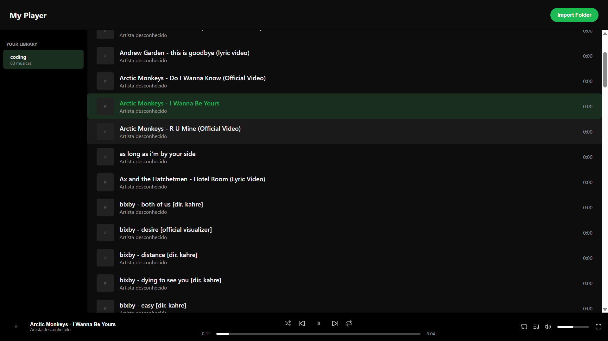

# Music Player

<p align="center">
  <strong>Your music, your way.</strong>
  <br />
  Um player de música para desktop desenvolvido com React, TypeScript, CSS, Python, Vite e Electron.
  <br /><br />
  
</p>

---

## Sobre o projeto

O **Music Player** é uma aplicação desktop desenvolvida para reproduzir e organizar músicas armazenadas localmente no computador.

Com uma interface intuitiva, o aplicativo permite importar pastas de músicas, construir uma biblioteca pessoal e controlar a reprodução de arquivos de áudio em um único lugar.

O projeto foi desenvolvido como uma experiência prática de aprendizado, explorando a integração entre tecnologias web e recursos nativos por meio do Electron.

## Status do projeto

**Projeto arquivado — sem desenvolvimento ativo.**

O desenvolvimento foi interrompido devido a limitações relacionadas à integração com serviços externos de música, especialmente Spotify e YouTube, utilizados na proposta original do projeto.

O player foi desenvolvido principalmente para trabalhar com arquivos de áudio locais. Portanto, o arquivamento está relacionado às funcionalidades planejadas de integração com esses serviços, e não necessariamente à reprodução de arquivos locais.

O repositório permanece público como parte do meu portfólio e como registro do aprendizado adquirido durante o desenvolvimento.

## Funcionalidades

- Reprodução de músicas armazenadas localmente
- Importação de pastas de músicas
- Persistência da biblioteca musical
- Controles de reprodução
- Avançar e voltar entre faixas
- Controle de volume
- Barra de progresso e duração das músicas
- Exibição de capas de álbuns
- Busca de capas online
- Leitura de metadados dos arquivos de áudio
- Organização de uma biblioteca pessoal
- Interface dedicada para desktop

## Formatos de áudio

O projeto foi preparado para trabalhar com os seguintes formatos:

| Formato | Extensão |
|---|---|
| MPEG Audio Layer III | `.mp3` |
| Free Lossless Audio Codec | `.flac` |
| Waveform Audio File Format | `.wav` |
| MPEG-4 Audio | `.m4a` |
| Ogg Vorbis | `.ogg` |

A reprodução efetiva depende da implementação utilizada e do suporte de áudio disponível no ambiente.

## Tecnologias utilizadas

| Tecnologia | Utilização |
|---|---|
| React | Construção da interface e componentização |
| TypeScript | Tipagem estática e organização da lógica da aplicação |
| CSS | Estilização e layout |
| Vite | Servidor de desenvolvimento e build |
| Electron | Execução da aplicação como software desktop |
| Python | Recursos auxiliares relacionados ao projeto |
| Node.js | Ambiente de execução e integração com recursos do sistema |
| `music-metadata` | Leitura de metadados de arquivos de áudio |

## Aprendizados

Durante o desenvolvimento, o projeto proporcionou experiência prática com:

- Desenvolvimento de interfaces com React.
- Organização e reutilização de componentes.
- Tipagem estática com TypeScript.
- Gerenciamento de estados e eventos.
- Integração entre React, Vite e Electron.
- Comunicação entre o processo principal do Electron e a interface.
- Manipulação e leitura de arquivos locais.
- Reprodução de áudio e controle de mídia.
- Extração de metadados de arquivos.
- Persistência de dados da aplicação.
- Integração com serviços e fontes externas de informação.

## Estrutura do projeto

A estrutura principal foi organizada para separar a interface, os estilos e os recursos específicos do Electron.

```text
music-player/
├── electron/
│   ├── main.cjs
│   └── preload.cjs
├── src/
│   ├── components/
│   ├── styles/
│   └── App.tsx
├── package.json
├── vite.config.ts
└── README.md
```

*Observação: ajuste a estrutura acima para corresponder aos diretórios e arquivos reais do repositório.*

## Execução local

Para executar o projeto em um ambiente de desenvolvimento, é necessário ter o Node.js e o npm instalados.

1. Clone o repositório:

   ```bash
   git clone <URL_DO_REPOSITORIO>
   ```

2. Entre na pasta do projeto:

   ```bash
   cd music-player
   ```

3. Instale as dependências:

   ```bash
   npm install
   ```

4. Inicie o ambiente de desenvolvimento, caso o script esteja disponível:

   ```bash
   npm run dev
   ```

**Nota:** como o projeto está arquivado, a execução depende das dependências, configurações e integrações presentes na versão atual do código.

## Autor

**Jorge Preisler**

Desenvolvido como projeto de estudo, com foco no aprendizado de React, TypeScript e desenvolvimento de aplicações desktop com Electron.

---

<p align="center">
  <strong>Music Player</strong>
  <br />
  <em>Listen. Organize. Enjoy.</em>
</p>